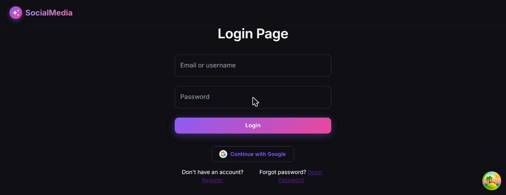
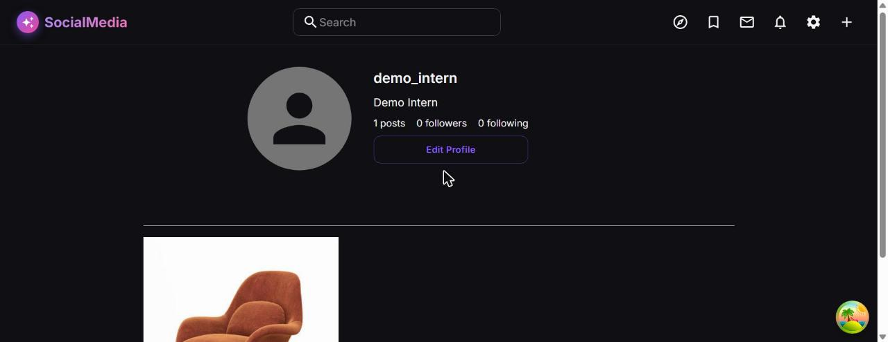
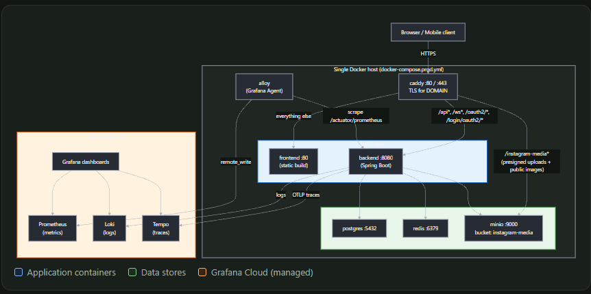

# Instagram Social

[](https://github.com/minhdau156/Instagram-Social/actions/workflows/ci.yml)

A full-stack, Instagram-style social media platform. You can share photos and videos, follow people, like and comment, chat in real time, and get live notifications. It also includes an admin panel with role-based moderation tools.

**🔗 Live demo:** [instagram-by-minhdau156.duckdns.org](https://instagram-by-minhdau156.duckdns.org/)

| Login | Profile | Post detail |
|---|---|---|
|  |  |  |

## Contents

- [Features](#features)
- [Tech Stack](#tech-stack)
- [Architecture](#architecture)
- [Getting Started](#getting-started)
- [Testing](#testing)
- [Deployment](#deployment)
- [Project Status](#project-status)
- [Documentation](#documentation)

## Features

### Accounts & profiles
- Sign up with email and password, or with **Google OAuth2**.
- Login uses **JWT access tokens and refresh tokens**. Logging out revokes the refresh token.
- **Password reset** by email, using a one-time token.
- Edit your full name, bio, and avatar.
- Set your account to **public**, **followers-only**, or **private**.
- Export all of your posts as a **CSV** file.

### Posts & media
- Each post can hold several images or videos (a carousel), plus a caption and a location.
- A built-in **crop editor** (square crop with zoom).
- Files upload **directly to object storage** (MinIO) through pre-signed URLs. Large files use **resumable multipart uploads**.
- Uploads are checked on the server:
  - Allowed types: JPEG, PNG, WebP (up to 10 MB, 8192×8192 px) and MP4 (up to 100 MB).
  - JPEG and PNG images are re-encoded to **remove EXIF metadata such as GPS location**.
- After posting, you can edit the caption and location. Deleting a post hides it (a soft delete) instead of erasing it.
- `#hashtags` and `@mentions` are found in captions and comments automatically. Mentioned users get a notification.

### Interactions
- Like posts and comments, and see who liked a post.
- Write comments and **threaded replies**. You can edit and delete your own comments.
- **Save** posts to a private collection.
- **Share** a post by copying its link, or send it in a direct message.

### Social graph
- Follow and unfollow people, and see follower and following lists on each profile.
- Following a **private account** sends a **follow request**. The account owner approves or declines it.
- Suggested users to follow.

### Feed & discovery
- **Home feed**: posts from people you follow come first, newest first. It loads more as you scroll (cursor-based pagination).
- **Explore**: popular posts from accounts you don't follow, ranked by likes plus comments, and **trending hashtags**.
- The first page of the feed and of Explore is **cached in Redis**.

### Search
- One search bar finds **users**, **hashtags**, and **posts**:
  - Users are found by username or full name using PostgreSQL full-text search, then sorted by follower count.
  - Hashtags are sorted by how many posts use them. Each hashtag has its own page.
  - Posts are found by caption and ranked by relevance.
- **Recent searches** are saved for each user and can be cleared.
- Users you blocked (or who blocked you) and deleted accounts never show up in results.

### Direct messages
- **One-to-one and group chats**. In a group, you can add members or leave.
- Messages arrive in real time over **WebSocket (SockJS + STOMP)**. A **typing indicator** shows when someone is writing.
- **Read receipts**. Each conversation shows its own unread count, and the navigation badge counts unread conversations. Both update live.
- You can send text, images, videos, and shared posts.

### Notifications
- Notifications arrive in real time over WebSocket, with a live unread badge.
- You're notified about likes, comments, replies, mentions, follows, follow requests, messages, and shares.
- See them in a dropdown or on a full page. Mark one as read, or all at once.
- **Notification settings**: turn each category on or off.

### Safety & moderation
- **Report** users, posts, comments, or messages. Reasons include spam, hate speech, nudity, violence, harassment, and false information.
- **Block** users. Their content is hidden from your feed, Explore, and search.

### Admin panel
- A dashboard, a **report review queue**, and **user management** (search, suspend, unsuspend).
- **Role-based access control**: the roles are `USER`, `MODERATOR`, `ADMIN`, and `SUPER_ADMIN`, and each role has its own set of permissions. A super admin can change those permissions and assign roles to users. The UI only shows actions you're allowed to take.
- **Bulk import posts from CSV** with Spring Batch, and track each import job.

### Reliability & operations
- **Rate limiting** per IP with Bucket4j. Registration allows 5 requests per 10 minutes, and the rest of the API allows 200 requests per minute.
- **Idempotency keys** (`Idempotency-Key` header), so a retried request isn't processed twice.
- **Observability**: Prometheus metrics, Grafana dashboards, Loki logs, and Tempo traces.
- **Swagger UI** documents every REST endpoint.

## Tech Stack

| Layer | Technology |
|---|---|
| Backend | Java 21, Spring Boot 3.3, Spring Security, Spring Data JPA / Hibernate, Spring Batch |
| Database | PostgreSQL 15 with full-text search; migrations run by Flyway |
| Auth | JWT + OAuth2 (Google) |
| Real-time | Spring WebSocket (STOMP) on the server; SockJS + STOMP.js in the browser |
| Caching | Redis (feed, profiles, comments) and Caffeine (rate-limit buckets) |
| File storage | MinIO (S3-compatible) |
| API docs | SpringDoc OpenAPI (Swagger UI) |
| Frontend | React 18, TypeScript, Vite, Material UI, TanStack React Query, Axios |
| Observability | Prometheus, Grafana, Loki, Tempo |
| CI/CD | GitHub Actions |
| Hosting | AWS EC2 (ARM), with Caddy as the reverse proxy |

## Architecture

The backend uses **Hexagonal Architecture (Ports & Adapters)**. Dependencies always point inward, toward the domain:

```
backend/src/main/java/com/instagram/
├── domain/              # Entities, value objects, exceptions (no framework code)
│   ├── model/
│   ├── port/in/         # Use-case interfaces (driving ports)
│   ├── port/out/        # Repository/service interfaces (driven ports)
│   └── service/
├── application/         # Use-case implementations
├── adapter/
│   ├── in/web/          # REST controllers + DTOs
│   ├── in/batch/        # Spring Batch CSV import
│   └── out/             # Persistence (JPA), messaging (WebSocket), push
└── infrastructure/      # Config, security (JWT/OAuth2), storage, interceptors
```

```
frontend/src/
├── api/          # One API client per domain (postsApi.ts, usersApi.ts, …)
├── components/   # Reusable UI, grouped by feature
├── pages/        # Route-level pages
├── hooks/        # Custom hooks (useAuth, useWebSocket, …)
├── types/        # TypeScript types
├── App.tsx       # QueryClient + ThemeProvider + Router
└── theme.ts      # MUI theme
```

For the deployment architecture diagram, see [docs/diagrams.md](docs/diagrams.md).

## Getting Started

### Prerequisites
- Java 21 and Maven
- Node.js 20 and npm (the version CI uses)
- Docker and Docker Compose

### Run locally

```bash
# 1. Create the environment file, then set JWT_SECRET (at least 32 random characters)
cp .env.example backend/.env

# 2. Start the infrastructure
docker compose up -d postgres minio redis

# 3. Start the backend (Flyway runs the migrations on startup)
cd backend && mvn spring-boot:run

# 4. Start the frontend (in a second terminal)
cd frontend && npm install && npm run dev
```

To start the full stack, including observability, run `docker compose up -d`.

### Local URLs

| Service | URL |
|---|---|
| Frontend | http://localhost:5173 |
| Backend API | http://localhost:8080 |
| Swagger UI | http://localhost:8080/swagger-ui.html |
| PostgreSQL | localhost:5432 (database: `instagram`) |
| MinIO Console | http://localhost:9001 |
| Grafana | http://localhost:3000 |
| Prometheus | http://localhost:9090 |

## Testing

```bash
# Backend: unit + integration tests, with JaCoCo coverage
cd backend && mvn verify

# Frontend: unit tests (Vitest)
cd frontend && npm test

# Load tests (k6): scenarios are in k6/scenarios/ (feed.js, login.js)
k6 run k6/scenarios/feed.js
```

## Deployment

Production runs on a single EC2 instance (`t4g.small`, ARM/Graviton). **Caddy** is the only public entry point. It handles HTTPS and routes each request by path to the backend, MinIO, or the frontend. The production stack is defined in [deploy/docker-compose.prod.yml](deploy/docker-compose.prod.yml).

For the full breakdown, and the reasons behind each decision, see [docs/diagrams.md](docs/diagrams.md) and the [ec2-deployment skill](.agents/skills/ec2-deployment/).



| EC2 instance | Instance details | Security group |
|---|---|---|
|  |  |  |

## Project Status

| Phase | Scope | Status |
|---|---|---|
| 0 | Foundation & infrastructure | ✅ |
| 1 | Auth & user management | ✅ |
| 2 | Posts & media | ✅ |
| 3 | Social graph (follow / unfollow) | ✅ |
| 4 | Likes, comments, saves, shares | ✅ |
| 5 | Feed & discovery | ✅ |
| 6 | Direct messaging (WebSocket) | ✅ |
| 7 | Notifications | ✅ |
| 8 | Search | ✅ |
| 9 | Content moderation & admin | ✅ |
| 10 | Performance, security & polish | 🚧 In progress |

**Known gaps:** mobile push notifications are only logged; nothing is sent to Firebase Cloud Messaging (FCM) yet. Video thumbnail generation isn't built yet.

## Documentation

| Topic | Location |
|---|---|
| Business requirements | [docs/prd/](docs/prd/) |
| Development roadmap | [docs/plan.md](docs/plan.md) |
| Database schema | [docs/database/schema.sql](docs/database/schema.sql) |
| Architecture & flow diagrams | [docs/diagrams.md](docs/diagrams.md) |
| User stories | [docs/userstories/](docs/userstories/) |
