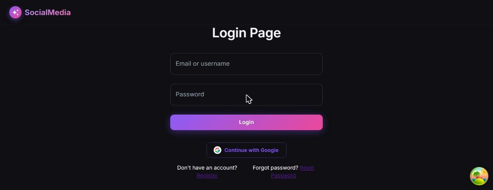
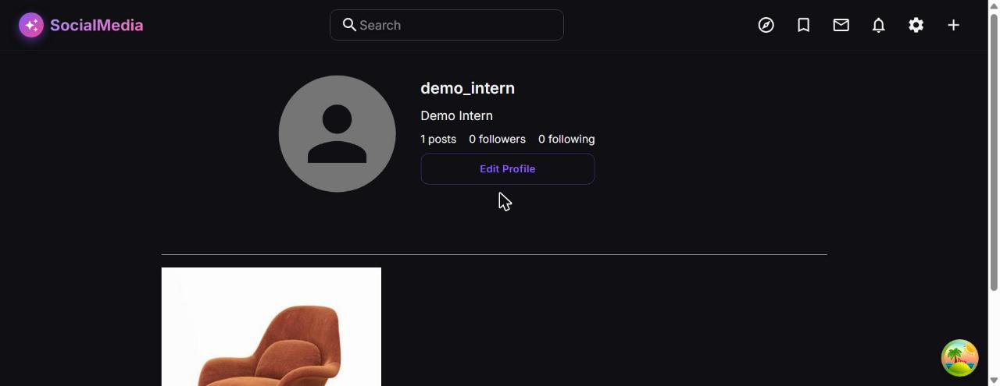

# Instagram Social

[](https://github.com/minhdau156/Instagram-Social/actions/workflows/ci.yml)

A full-stack social media platform inspired by Instagram. Users can share photos and videos, follow each other, like and comment on posts, and chat in real time.

## Screenshots

| Login | Profile | Post detail |
|---|---|---|
|  |  |  |

No live demo is hosted yet. Run it locally — see [First-Time Local Setup](#first-time-local-setup).

## Status

- ✅ Phase 0 — Foundation & Infrastructure
- ✅ Phase 1 — Auth & User Management
- ✅ Phase 2 — Posts & Media
- ✅ Phase 3 — Social Graph (Follow/Unfollow)
- ✅ Phase 4 — Interactions (Likes, Comments, Saves, Shares)
- ✅ Phase 5 — Feed & Discovery
- ✅ Phase 6 — Direct Messaging (WebSocket)
- ✅ Phase 7 — Notifications
- ✅ Phase 8 — Search
- ✅ Phase 9 — Content Moderation & Admin
- 🚧 Phase 10 — Performance, Security & Polish (in progress)

## Tech Stack

| Layer | Technology |
|---|---|
| Backend Language | Java 21 |
| Backend Framework | Spring Boot 3.3 |
| ORM | Spring Data JPA / Hibernate |
| Database | PostgreSQL 15 |
| DB Migration | Flyway |
| Auth | Spring Security + JWT + OAuth2 (Google, Facebook) |
| Real-time | Spring WebSocket (STOMP) |
| Caching | Redis, Caffeine |
| File Storage | MinIO (local) / AWS S3 (production) |
| API Docs | SpringDoc OpenAPI (Swagger UI) |
| Frontend Framework | React 18 + TypeScript |
| Build Tool | Vite |
| UI Library | Material UI (MUI) |
| Data Fetching | TanStack React Query |
| HTTP Client | Axios |
| Real-time (frontend) | SockJS + STOMP.js |
| Observability | Prometheus, Grafana, Loki, Tempo |
| CI/CD | GitHub Actions |

## Architecture

The backend follows **Hexagonal Architecture (Ports & Adapters)** — dependencies only point inward, toward the domain:

```
backend/src/main/java/com/instagram/
├── domain/           # Entities, value objects, exceptions — no framework code
│   ├── model/
│   ├── port/
│   │   ├── in/       # Use-case interfaces (driving ports)
│   │   └── out/      # Repository/service interfaces (driven ports)
│   └── service/
├── application/
│   └── usecase/      # Use-case implementations
├── adapter/
│   ├── in/web/        # REST controllers + DTOs
│   └── out/
│       ├── persistence/  # JPA entities, repositories
│       └── messaging/    # WebSocket/event adapters
└── infrastructure/
    ├── config/        # Spring beans, CORS, OpenAPI
    ├── security/       # JWT filter, OAuth2 handlers
    └── storage/        # S3 / MinIO file storage
```

Frontend structure:

```
frontend/src/
├── api/          # One file per domain (postsApi.ts, usersApi.ts, …)
├── components/   # Shared reusable UI components
├── pages/        # Route-level page components
├── hooks/        # Custom React hooks (useAuth, useWebSocket, …)
├── types/        # TypeScript interfaces / enums
├── App.tsx       # Root: QueryClient + ThemeProvider + Router
└── theme.ts      # MUI theme tokens
```

## First-Time Local Setup

1. Copy the example environment file and fill in your values: `cp .env.example backend/.env`
2. Edit `backend/.env` — at minimum set `JWT_SECRET` to a random string of at least 32 characters.
3. Start the local Docker stack (PostgreSQL + MinIO): `docker compose up -d postgres minio`
4. Run the backend: `cd backend && mvn spring-boot:run`
5. Run the frontend: `cd frontend && npm install && npm run dev`

## Local Development

| Service | URL |
|---|---|
| Backend API | http://localhost:8080 |
| Swagger UI | http://localhost:8080/swagger-ui.html |
| Frontend | http://localhost:5173 |
| PostgreSQL | localhost:5432 (db: `instagram`) |
| MinIO Console | http://localhost:9001 |

Full observability stack (Prometheus, Grafana, Loki, Tempo) is available via `docker compose up -d`.

## Testing

```bash
# Backend — unit + integration tests, JaCoCo coverage
cd backend && mvn verify

# Frontend — unit tests
cd frontend && npm test

# Load testing
k6 run k6/scenarios/<scenario>.js
```

## Documentation

- Product spec: `docs/prd/`
- Development plan: `docs/plan.md`
- Database schema: `docs/database/schema.sql`
- Troubleshooting: `docs/troubleshooting.md`
