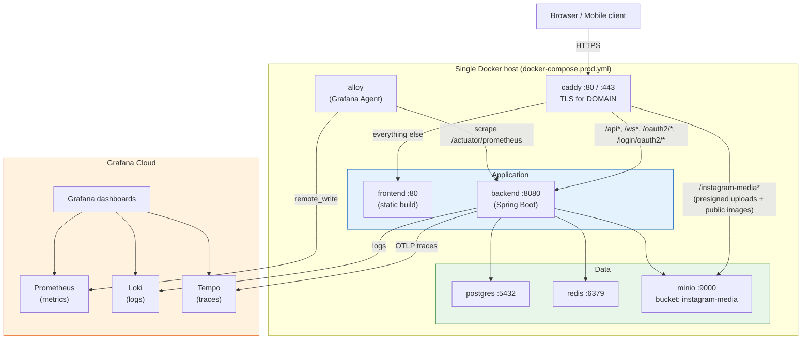

# Architecture & Flow Diagrams

All diagrams are written in [Mermaid](https://mermaid.js.org/) and render natively on GitHub.
To preview locally, install the
[Markdown Preview Mermaid Support](https://marketplace.visualstudio.com/items?itemName=bierner.markdown-mermaid)
VS Code extension.

---

## Deployment Architecture

Sourced from `deploy/docker-compose.prod.yml`, `deploy/Caddyfile`, and `deploy/alloy/config.alloy`. A single EC2 host runs every container; Caddy is the one public entry point and routes by path to the backend, MinIO, or the frontend. Backend logs and traces go straight to Grafana Cloud; only metrics are relayed through Alloy.

**Why MinIO is routed through Caddy, not called directly:** MinIO issues presigned upload/read URLs signed with whatever endpoint it was told it's reachable at (`MINIO_ENDPOINT: https://${DOMAIN}`). Routing `/instagram-media*` through Caddy on the same domain means those presigned URLs resolve over HTTPS on the public domain instead of an internal `minio:9000` address the browser could never reach.

**Why logs/traces skip Alloy:** the backend is configured to ship OTLP traces (`OTEL_ENDPOINT`) and logs (`LOKI_URL`) directly to Grafana Cloud with Basic Auth baked into the request headers. Alloy's only job here is scraping `/actuator/prometheus` and remote-writing it — there's no local Prometheus/Loki/Tempo to relay through, unlike the `docker-compose.yml` (local dev) stack which runs its own Grafana/Prometheus/Loki/Tempo containers.
